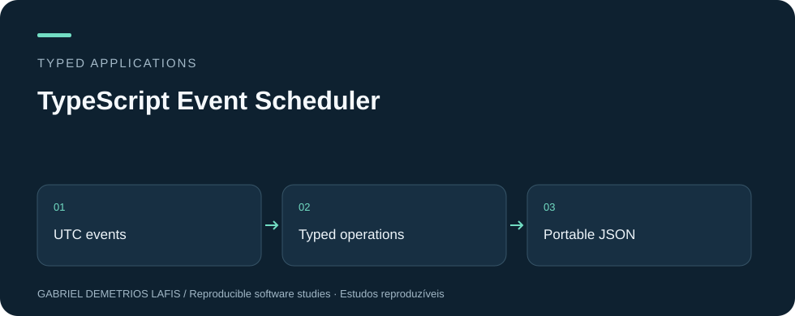
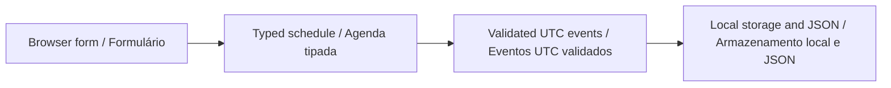

# TypeScript Event Scheduler

**Typed applications · Aplicações tipadas**

<p align="center"></p>

[](https://github.com/galafis/TypeScript-Event-Scheduler-Improved/actions/workflows/ci.yml)
[English](#english) · [Português](#portugues) · [Guided tour / Visita guiada](docs/SHOWCASE.md) · [Validation / Validação](docs/VALIDATION.md)

> **EN:** Does an event remain on the intended UTC day after JSON exchange?<br>
> **PT:** Um evento continua no dia UTC esperado após a troca por JSON?

## Start here · Comece aqui

| Goal · Objetivo | Where to go · Por onde começar |
| --- | --- |
| Understand a real example · Entender um exemplo concreto | [Walkthrough / Roteiro](examples/demo.mjs) |
| Reproduce and compare · Reproduzir e comparar | [Evidence tour / Visita às evidências](docs/SHOWCASE.md) |
| Inspect the checks · Inspecionar as verificações | [Validation record / Registro de validação](docs/VALIDATION.md) · [CI](https://github.com/galafis/TypeScript-Event-Scheduler-Improved/actions/workflows/ci.yml) |
| Explore in the browser · Explorar no navegador | [Public demonstration / Demonstração pública](https://galafis.github.io/TypeScript-Event-Scheduler-Improved/) |

**Example result · Resultado do exemplo:** The example adds one design-review event at 2026-10-01T14:00:00Z and verifies it belongs to that UTC day. / O exemplo adiciona uma revisão de projeto em 2026-10-01T14:00:00Z e verifica o dia UTC correspondente.

**Try a comparison · Experimente uma comparação**<br>
**EN:** Export the design-review event, import it again and inspect UTC day filtering and duplicate-ID rejection.<br>
**PT:** Exporte o evento de revisão, importe novamente e inspecione o filtro de dia UTC e a rejeição de IDs duplicados.

<a id="english"></a>

## English

A typed scheduling library with a complete bilingual browser interface, UTC day filtering and portable JSON import and export.

### What works

- Create, update, delete and sort events; duplicate identifiers are rejected.
- Defensive Date copies protect stored events from mutation by callers.
- JSON import validates the entire schedule before replacing it; browser storage keeps the local agenda.

### Reproducible walkthrough

Requirements: Node.js 24+ and pnpm 11 / Node.js 24+ e pnpm 11.

Run from the repository root. The validation environment installs the components exercised by the tests and documented example; optional integrations may need their separate dependencies.

```sh
pnpm install --frozen-lockfile
pnpm test
pnpm build
```

**Input contract / Contrato de entrada:** `{id, name, date: Date, description?}`; JSON dates require an explicit timezone / datas JSON exigem fuso explícito.

**Expected behavior / Comportamento esperado:** The example adds one design-review event at 2026-10-01T14:00:00Z and verifies it belongs to that UTC day. / O exemplo adiciona uma revisão de projeto em 2026-10-01T14:00:00Z e verifica o dia UTC correspondente.

### Architecture / Arquitetura



The main path can be followed in [src/EventScheduler.ts](src/EventScheduler.ts). Examples call the actual implementation and include assertions; they are not pseudocode.

### Scope and assumptions

Dates in the browser form are UTC, not local time. No calendar synchronization, reminders, collaboration server or recurring-event engine is included. Browser storage can be cleared; export backups when needed.

### Changes verified in this review

Restored the missing scheduling implementation and browser module; repaired the build; added immutable reads, UTC boundary tests and atomic JSON import.

<a id="portugues"></a>

## Português

Biblioteca tipada de agendamento com interface bilíngue completa, filtros por dia UTC e importação e exportação JSON.

### Funcionalidades disponíveis

- Crie, altere, exclua e ordene eventos; identificadores duplicados são rejeitados.
- Cópias defensivas de Date protegem eventos contra alterações feitas por quem usa a biblioteca.
- A importação JSON valida toda a agenda antes de substituí-la; o armazenamento do navegador preserva a agenda local.

### Execução reproduzível

Use os comandos da seção acima a partir da raiz do repositório. Requisitos: Node.js 24+ and pnpm 11 / Node.js 24+ e pnpm 11. O ambiente de validação instala os componentes exercitados pelos testes e pelo exemplo documentado; integrações opcionais podem exigir dependências próprias.

O fluxo principal está em [src/EventScheduler.ts](src/EventScheduler.ts). Os exemplos usam a implementação real e verificam resultados com asserções; não são pseudocódigo. O diagrama apresenta os mesmos passos nos dois idiomas.

### Escopo e premissas

Datas do formulário são UTC, não hora local. Não há sincronização de calendário, lembretes, servidor colaborativo ou eventos recorrentes. O armazenamento do navegador pode ser apagado; exporte cópias quando necessário.

### Melhorias verificadas nesta revisão

Restaurados implementação de agendamento e módulo do navegador; corrigida compilação; adicionados leitura protegida, testes de limites UTC e importação JSON atômica.

### Run the application / Executar a aplicação

```sh
python -m http.server 8080 --directory docs
```

```sh
node examples/demo.mjs
```

Open / Abra: http://localhost:8080.

## Repository guide / Guia do repositório

| Location / Local                                            | Purpose / Finalidade                                                   |
| ----------------------------------------------------------- | ---------------------------------------------------------------------- |
| [Implementation / Implementação](src/EventScheduler.ts)     | Main domain behavior / Comportamento principal do domínio              |
| [Example / Exemplo](examples/demo.mjs)                      | Executable scenario / Cenário executável                               |
| [Tests / Testes](tests/)                                    | Normal behavior and failure cases / Fluxos válidos e casos de falha    |
| [Validation notes / Notas de validação](docs/VALIDATION.md) | Corrections, evidence and boundaries / Correções, evidências e limites |
| [Workflow / Automação](.github/workflows/ci.yml)            | Automated checks / Verificações automatizadas                          |

## Development / Desenvolvimento

EN: When changing behavior, update the contract, the worked example and a regression test together. Keep synthetic fixtures separate from real data. A passing test suite demonstrates the listed software behaviors; it does not certify a deployment or domain outcome.

PT: Ao alterar comportamento, atualize em conjunto o contrato, o exemplo e um teste de regressão. Separe amostras fictícias de dados reais. Testes aprovados demonstram os comportamentos de software listados; não certificam implantação nem resultado no domínio.

Author / Autor: [Gabriel Demetrios Lafis](https://github.com/galafis) · [Institutional contact / Contato institucional](mailto:gabrieldemetrioslafis@usp.br)

License / Licença: [repository license](LICENSE).

## Additional contract checks · Verificações adicionais de contrato

JSON import rejects impossible calendar dates, invalid time components and unknown fields before replacing existing events. Leap years, fractional seconds and explicit UTC offsets are checked; accepted dates use four-digit UTC years (0000–9999).

A importação JSON rejeita datas impossíveis, componentes de horário inválidos e campos desconhecidos antes de substituir eventos. Anos bissextos, frações de segundo e fusos explícitos são verificados; datas aceitas usam anos UTC de quatro dígitos (0000–9999).
